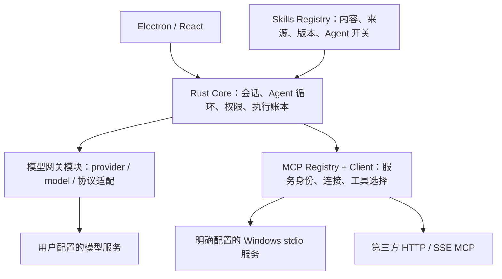

# Magpie 采用方案

状态：2026-11-01 用户已确认 Skills/MCP 统一资料库、按 Agent 分配、TROOP 自身运行时检查，以及“Rust 内置网关，Magpie 可选”路线。范围：[本地集成、记忆与自动化决策](https://github.com/Slmplez/TROOP/issues/8)。本文件是正式规格的设计输入，不是已实现模块的说明。

## 参考基线

研究固定在 [yetone/magpie@1fac66c](https://github.com/yetone/magpie/commit/1fac66c06d11de9e4232270862da0fa0a3ad90f6)，防止研究期间默认分支变化。只读源码与文档，没有安装或运行 Magpie，没有读取用户的其他 Agent 配置或凭据。

Magpie 的网关主要是本地模型协议代理；其资料库可将 Skills/MCP 等配置写到不同外部 Agent 的配置。其项目使用 Go/Wails；这不是 TROOP 已确认的 Rust Core + Electron 技术栈。[README](https://github.com/yetone/magpie/blob/1fac66c06d11de9e4232270862da0fa0a3ad90f6/README.zh-CN.md)、[go.mod](https://github.com/yetone/magpie/blob/1fac66c06d11de9e4232270862da0fa0a3ad90f6/go.mod)

仓库声明为 MIT；若以后复制实质代码或材料，应保留对应版权与许可声明。本轮只引用设计并记录来源，不把第三方源码直接混入生产工程。[LICENSE](https://github.com/yetone/magpie/blob/1fac66c06d11de9e4232270862da0fa0a3ad90f6/LICENSE)

## 已确认的采用边界

| 模块 | 借鉴方向 | 保留 TROOP 的约束 |
|---|---|---|
| Skills | 一处管理技能内容、来源和版本；按 Agent 分配，明确导入与同步状态 | Grok Bot 的用户技能库、Agent 禁用列表、@workflow/Run Now 与 frontmatter 行为继续有效；启用状态必须在发现、注入和调用处检查 |
| MCP | 一处管理服务配置、账号状态、工具发现和按 Agent 选择 | 服务 UUID 与工具名组成稳定身份；Windows 执行位置明确；调用进入 Core 授权、调用账本、取消与结果不明链路 |
| 网关 | 将 provider、model、凭据引用、协议适配、流式输出与路由抽象为独立模块 | Rust Core 仍拥有 Agent 循环与任务事实；网关不能绕开任务取消、预算、授权或更换未经允许的数据接收方 |

首先独立实现 Rust 模块，复用设计和契约，Electron 继续作为 TROOP 外壳。连接外部 Magpie 作为用户显式配置的兼容 endpoint 选项，不是产品启动依赖。供其他 Agent 使用的本地 HTTP 服务属于后续可选能力，内部模型请求不强加一层 HTTP。

模型网关和 MCP 客户端是不同角色，不与 Windows 输入控制器、应用 IPC 或 Docker 执行环境混用。Docker 仍暂停。

## 需要在借鉴时防止的语义变化

- 文件分发成功不等于某个 Agent 已获准使用技能。共享目录可能被其他 Agent 自动扫描，不能用“复制/链接在哪个目录”取代启停规则。
- MCP hub 的聚合能力不等于完整 MCP client。要逐项核对 tools、resources、prompts、认证、取消、重新连接和账号隔离，不能把缺失能力当成可删除的需求。
- 会话失效后重开连接可以重做发现，但不得自动重发可能已产生副作用的旧工具调用。超时、断开或错误不是“什么都没发生”的证据。
- 网关请求重试与工具执行重试分别处理。已转发的流式片段、工具调用 ID、推理与最终回复不能在切换模型后无条件拼接；必须保留可解释的失败和执行核对。
- 跨 provider/账号自动切换、导入其他 Agent 登录信息、自动改写其他 Agent 配置、局域网共享、遥测或自动下载插件运行时，都不因“借鉴 Magpie”而自动纳入 TROOP。
- 来源缓存或第三方脚本不改变权限上限。Skills 的脚本、MCP 的服务进程、模型网关的中间件必须按各自真实执行能力处理，不能统一视作提示词文本。

## 研究与决策边界

三个原始研究报告均已完成，区分源码事实、已阅读测试的覆盖意图和未验证行为。此处采用方向已获用户确认；它不宣称 Magpie 或 TROOP 的运行结果。旧机制兼容与本地替代规则见 [集成契约](CONTRACT.md)。

| 研究报告 | 最影响本方案的发现 |
|---|---|
| [Skills](../../docs/research/troop-magpie-skills-2026-11-01.md) | 适合借鉴导入探测、版本/本地修改保护及归属记录；主要分发文件，不提供统一执行器；共享目录可被未勾选 Agent 看见；frontmatter 仅 name/description，不能替代 TROOP 的既有调用语义 |
| [MCP](../../docs/research/troop-magpie-mcp-2026-11-01.md) | 适合借鉴服务资料库、诊断和 OAuth 状态；hub 只有 tools，后端按服务名共享；通用入口范围大于单 Agent 勾选；401/404 路径可能重发调用，需要重新设计 |
| [模型网关](../../docs/research/troop-magpie-gateway-2026-11-01.md) | 可借鉴 provider/model/attempt 分离、取消传播、内容提交边界和有限 fallback；不能把本机计量 token 当认证，也不能把普通私有 JSON 文件当 Windows 系统凭据加密 |

以上相对链接在本工作区用于导航；独立发布附件保留相同目录布局。所有外部结论的原始引用均使用固定 SHA，不能以测试文件存在推断测试已通过。

## 模块设计与开发验收

### Skills Registry

建立内容、来源、版本和 Agent 绑定的一处管理入口。默认导入副本，显式选择时才建立 live source；不移动用户原目录，不把 Agent 侧副本修改自动回写全局库。导入/更新展示冲突，保留本地修改和原始来源；只清理自身拥有且未被用户改写的材料。

TROOP 内部直接消费注册表，无需靠写入其他 Agent 配置获得能力。保留 Grok Bot 的全局用户技能库、Agent 禁用列表、@workflow/Run Now 与 frontmatter 规则；发现、上下文注入、手动调用分别执行启停检查。跨工作区可见范围由本产品的明确 scope 决定，不能因共享目录已存在就变成授权。

### MCP Registry + Client

借鉴集中添加、连接状态、诊断、OAuth 和按 Agent 选工具的交互。使用服务 UUID + 原工具名建立身份，运行时再核对当前 Agent、任务、工作区与授权；不能把一个公开聚合入口暴露的所有服务当作当前任务的工具集。

Windows stdio 的命令、cwd、环境和凭据用途明确；第三方 HTTP/SSE 服务由独立 transport 接入。会话连接按执行位置、身份/账号、配置修订和适用工作区隔离，只有可证明等价时才共享。工具结果、附件、resources/prompts 等协议能力按 TROOP 原能力清单实现，不用 Magpie tools-only hub 缩减需求。

认证失败、会话丢失和列表失效分别处理。可重连、刷新凭据和重新发现工具；可能已产生副作用的 tools/call 不随 401/404 自动重放，进入执行核对。取消等待不等于服务端工作已停止；调用账本保留独立结果状态。系统凭据存储保存长期秘密，普通配置只保存引用。

### Rust 模型网关模块

在 Core 内设置模型目录、provider adapter、规范化请求/事件、尝试记录、取消和有限重试边界。先服务 TROOP 自身，保持 Agent 循环和业务状态由 Core 管理，不增加必需的 Go/Wails sidecar。用户可显式把已运行的 Magpie 作为兼容模型 endpoint，属于可选 provider，不自动扫描、启动或捆绑安装。

路由配置保存用户选择的逻辑模型和允许的实际 provider/model；每次尝试独立记录，限制一次执行的总重试预算。可借鉴“向调用方提交内容前才允许故障切换”的边界，取消后不切换；不得把已提交片段或工具事件与另一模型结果静默拼接。不把 transport 重放或假幂等 header 当供应商的幂等保证。

多账号池、外部 Agent 配置同步、对外 MCP hub、局域网共享与自动下载插件运行时不是本方案的默认依赖。若将来新增本机 HTTP API，另行定义调用认证、Origin/Host 校验和生命周期；loopback 地址本身不等于只有 TROOP 能访问。

### 开发验收增量

- Skills：禁用项不被发现/注入/调用；共享目录、重名、更新冲突、本地改动和撤销绑定都不越过 Agent 开关；不删除非本产品管理的文件。
- MCP：同名服务/工具、不同账号/工作区、配置修订隔离；401/404/超时不重放不明写调用；取消、重连、工具目录变化、OAuth 刷新/撤销和附件有可核对结果。
- 网关：流式工具调用与取消、首内容前后故障、两层重试、provider 切换约束和预算；密钥不进请求日志；外部 Magpie 停止时不把配置偷偷改成另一端点。
- 所有结论仍需正式 Rust 实现、确定性替身和指定真实服务分层验证；不为本轮讨论安装或运行 Magpie、MCP 服务或 Docker。

本轮仍按已回答的取舍保留：Grok Bot 自动记忆与 Agent/user/project 作用域；Windows 本机执行入口；错过定时任务跳过、可手动补跑及 DST 一次/跳过；原托管技能转为可管理的本地导入。
