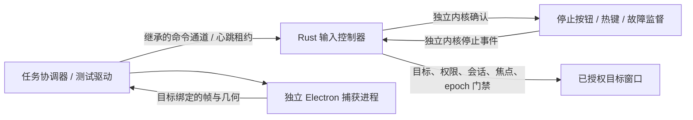

# Windows 本机控制验证矩阵

日期：2026-11-01；[验证 Windows 本机控制与人工接管闭环](https://github.com/Slmplez/TROOP/issues/6)仍是唯一任务状态源。

**当前单屏范围的架构可行性已具备收口依据；正式产品验收尚未完成。** 用户最新确认保留单屏、100% 缩放，多屏和混合 DPI 暂不需要，不再作为本期开发阻塞项。第五轮已补齐 12 项自动控制演练、真实停止按钮/热键、独立进程锁屏恢复和管理员目标拒绝。每次新运行记录实际源码哈希，旧失败保留，不以当前源码追认旧结果。

## 第五轮新增证据

| 验证项 | 结果 | 证据与限定 |
|---|---|---|
| 完整自动控制矩阵 | 12/12 通过 | isolation-current-results.json：正常点击、失焦、TTL、捕获阻塞/退出、EOF、租约、控制器/目标退出、排队背压、权限、部分结果注入 |
| 观察 TTL | 超过 5 秒返回 observation_expired，零输入 | 当前矩阵 stale-observation；已修复驱动错误引用旧 epoch |
| 有效队列 + 日志背压 | 内核 ACK 成功，独立读取目标命中计数为 0；期限后无旧输入，授权撤销、队列清空 | 当前矩阵 output-backpressure；诊断丢弃不适用于生产审计 |
| 部分结果 / 结果不明 | 注入 1/3 返回后撤销观察与授权、设置独立 ACK，拒绝重新授权和重试 | 当前矩阵 partial-result；**未调用 SendInput，不是实际 OS 部分提交样本** |
| 捕获阻塞时真实热键 | Computer Use 发送 Ctrl+Shift+F12 后清空队列、撤销授权；超过原 60 秒期限无输入 | isolation-hotkey-results.json；本轮工具权限已可用，旧超时记录保留 |
| 捕获阻塞时真实按钮 | 实际点击停止按钮，目标回调与停止 ACK 均记录；期限后无旧输入 | isolation-button-results.json；首次无截图元素点击因 geometry unavailable 未触发，重新观察截图后点击成功 |
| 独立架构真实锁屏 | 用户手动锁定/解锁；会话可用性从 false 恢复为 true，旧队列清除，超过原期限仍零输入 | isolation-lock-results.json；状态采样采用 WTS/输入桌面组合查询，**不是 WTS 通知回调记录** |
| 独立架构显式恢复 | 用户确认后重建捕获，旧轨道 ended，新帧含 900 个青色像素；新观察后的新动作实际命中 | 同上；新点击坐标来自新原生观察，色块仅作帧新鲜度前提，不冒充新图像坐标映射样本 |
| 真实管理员目标 | 普通检查器 IL 8192 对管理员目标 IL 12288，双方 UIAccess=0；higher_integrity_target，零输入调用 | elevated-results.json；用户手动确认 UAC，专用窗口自行退出，没有操作管理员应用内容 |
| 动态捕获持续采样 | 126.188 秒内 24 次采样均取得新帧，呈现帧计数从 24 增至 513；随后最小化、恢复、重建与关闭演练通过 | capture-soak-results.json；250 ms 更新一次自建窗口文字，无授权/输入；仅是短时动态夹具样本 |
| 捕获内存观测 | 捕获主进程 RSS 约 136.5–145.1 MiB | 同上；不含 renderer/GPU/系统总内存，不据此宣称无泄漏或长期稳定 |
| 静态画面无新帧 | 首次静态采样超时，轨道 live、目标可枚举 | capture-soak-static-result.json；保留失败，不能单凭不出帧推断捕获崩溃 |

初始前台准备最多等待 60 秒。工具只对每个新建专用窗口进行首次激活，不在失焦用例中替测试对象恢复焦点。控制器仍保留焦点、会话、目标身份、几何、授权及 epoch 检查。默认 12 项不包含人工锁屏、管理员确认或硬件测试。

## 第四轮及此前的历史证据

| 验证项 | 观察结果 | 证据 / 限定 |
|---|---|---|
| 图像定位后的点击 | 两种窗口位置/尺寸均真实命中，最大映射误差约 0.525 px | frame-click-results.json；单屏 DPI 96 |
| 锁屏取消排队动作 | WTS 清除已授权队列，解锁后超过原期限不重放 | queued-lock-results.json；原来的单进程输入原型 |
| 解锁捕获恢复 | 旧轨道结束，人工新观察后取得青色新帧及新点击 | capture-recovery-results.json；原来的单进程输入原型 |
| 独立输入进程 | Rust 控制器向独立目标进程成功点击；Electron 只捕获 | isolation-results.json / normal |
| 短暂失焦后返回 | 新增 WinEvent 前台事件锁存，300 ms 故障夹具使旧观察失效；恢复焦点后无旧动作，显式观察后新动作命中 | isolation-results.json / focus-pulse；仅自建窗口 |
| 捕获主循环阻塞 | 先取得真实媒体帧，再注入阻塞；停止确认约 24 ms，队列清空、期限后零输入 | isolation-results.json / capture-hang；不是自然发生的 WGC 卡死 |
| 捕获进程退出 | 注入退出码 73 后，停止确认约 20 ms，期限后零输入 | isolation-results.json / capture-exit；不是特定 GPU 崩溃复现 |
| 控制连接断开 | stdin EOF 后撤销授权、清空队列，期限后零输入 | isolation-results.json / channel-eof；毫秒时钟记录为 0 ms，不意味着零耗时 |
| 协调端心跳失联 | 停止续租后约 610 ms 清空队列；原型租约为 700 ms | isolation-results.json / lease-timeout；从最后心跳起算，参数不是生产 SLA |
| 控制器被终止 | Job Object 随句柄关闭回收它创建的专用目标 | isolation-results.json / helper-crash；绝不能将此规则用于用户现有应用 |
| 目标进程被终止 | 检测退出并停止，约 9 ms，期限后零输入 | isolation-results.json / target-crash |
| 未授权/旧 epoch/错误目标 | 均在提交前拒绝 | isolation-results.json；每个场景都有前置拒绝轨迹 |
| 跨完整性应用门禁 | 真正创建低完整性 4096 / UIAccess=0 子进程，对中完整性 8192 / UIAccess=0 目标返回 higher_integrity_target；策略路径零 OS 调用 | isolation-results.json / permission；共享完整性门禁，未运行管理员窗口 |
| OS 跨完整性诊断 | 独立绕过应用门禁的诊断返回 3/3，但目标 0 次命中；随后同目标中完整性正对照实际命中 | isolation-permission-diagnostic.json 和 isolation-results.json；保留不一致结果，不判定 OS 操作成功或单一 UIPI 根因 |
| 日志背压时停止确认 | 当时源码的内核停止确认成功；1853 条诊断消息被丢弃，最终 stopped=true、grant=false、pending=false | isolation-stop-transport-results.json；**该次没有有效观察或排队动作**，不能合并成“背压下排队取消已验证” |
| 捕获最小化/恢复/尺寸变化 | 最小化后 1 秒等待没有新帧，但轨道仍 live；恢复并改变尺寸后，旧流取得 1086×642 青色新帧 | capture-lifecycle-results.json；无授权、无观察、无输入，不代表所有应用的最小化行为 |
| 捕获重建与目标关闭 | 显式重建使旧轨道 ended，新轨道得到 900 个青色像素；关闭目标后无新帧、轨道 ended、源不再枚举 | capture-lifecycle-results.json；目标关闭时 Chromium 报 WGC source closed / GetFrame failed，符合本次故障注入 |

本节保留第四轮证据的原始语境。isolation-results.json 为当时 10 项中 9 项通过的记录，不能代替第五轮的 isolation-current-results.json。此前前台阻断和 Computer Use 授权超时已在第五轮解除。旧运行没有源码快照，不用新源码哈希追认它们。

## 正式实现验收及后续扩展

| 项目 | 当前原因 | 精确补测步骤 / 通过条件 |
|---|---|---|
| OS 真实部分提交的外部效果 | 已验证注入后的状态处理，尚无真实 OS 部分返回样本 | 正式工具账本仍须区分插入数量和实际效果，保留不确定结果，不自动重试 |
| 混合 DPI 多屏/跨屏负坐标/多屏布局与拔插 | 用户最新明确暂不需要；当前仅声明已验证单屏、100% 缩放 | 后续决定扩展时再按 README 矩阵验证，不阻塞本期规格或开发 |
| RDP / UIA 兼容边界 | 当前无对应会话或 UIA 目标夹具 | 对所承诺支持的环境分别取证；当前原型拒绝 RDP，不能宣称支持 |
| 长时间捕获、完整遮挡和设备变化 | 已有短时生命周期样本；持续采样记录单独列出，不能外推长期运行或任意遮挡 | 记录新帧时间、卡顿与资源占用；变化后旧观察失效，必须重新确认目标与新帧，不能仅检查轨道 live |

## 本轮架构结论（可继续验证的建议，不是生产实现）



- 捕获进程不能直接发送输入；控制器不等待捕获调用完成才处理停止。
- 媒体轨道的 live 状态不代表有可用新画面。观察必须绑定目标、捕获代际、几何版本和单调时间；最小化、帧超时或几何改变使旧观察失效，恢复出帧本身不能自动恢复输入资格。
- 停止确认只表示该运行的授权已撤销、未提交动作已清空；已进入 OS 的短动作仍需核对，不能撤回或盲目重试。
- 诊断日志必须与停止状态更新隔离。原型允许有界诊断队列丢消息以验证控制不阻塞；**生产审计账本不能沿用丢弃策略**，应独立持久化并定义缺失/结果不明语义。
- 生产 IPC 还需同用户权限、连接/进程身份验证、运行代际与消息大小/顺序约束。当前继承 stdin、命名事件和固定子进程仅证明原型边界，不是完成的授权协议。
- Job Object 只清理应用拥有的子进程。用户原本打开的浏览器、编辑器或管理员工具不属于可强制结束的范围。
- 本期单屏捕获采用已跑通的独立 Electron 定向媒体路径，输入采用独立 Rust 控制器，停止使用独立通道。原生 Rust WGC 是可选的未验证候选，不要求同时实现两个后端。正式实现仍需稳定性与真实任务集成验收，多屏扩展暂缓。

## 可复现入口

```powershell
# 在用户桌面前台条件满足时：完整自动矩阵，不包含人工停止入口
./.scratch/troop-windows-control/run-isolation.ps1 -Scenario all
# 不依赖有效观察，无排队、无输入：仅背压下的停止传输
./.scratch/troop-windows-control/run-isolation.ps1 -Scenario stop-transport
# 无授权、无输入：最小化、恢复并改变尺寸、重建捕获、关闭自建目标
./.scratch/troop-windows-control/run-isolation.ps1 -Scenario capture-lifecycle
# 动态专用窗口，24 次间隔约 5 秒的采样，再做生命周期演练；无输入
./.scratch/troop-windows-control/run-isolation.ps1 -Scenario capture-soak
# 需允许 Computer Use 或人工在专用窗口操作
./.scratch/troop-windows-control/run-isolation.ps1 -Scenario hotkey-stop
./.scratch/troop-windows-control/run-isolation.ps1 -Scenario button-stop
# 用户在场：手动锁屏/解锁；驱动等待明确的恢复确认文件
./.scratch/troop-windows-control/run-isolation.ps1 -Scenario manual-lock
# 用户在场：手动确认 UAC；只读检查管理员专用目标
./.scratch/troop-windows-control/run-elevated.ps1
```

初始前台等待超时或其他观察前置条件不满足时，矩阵停止后续重复启动。恢复工作不需要重做旧历史导入，只需完成本表明确的缺口。人工恢复文件只在收到用户本轮解锁确认且核对原期限后零输入后写入，禁止预置或复用旧轮文件。

依据：[SendInput 的返回值与 UIPI 限制](https://learn.microsoft.com/en-us/windows/win32/api/winuser/nf-winuser-sendinput)、[Windows 完整性控制](https://learn.microsoft.com/en-us/windows/win32/secauthz/mandatory-integrity-control)、[受限令牌](https://learn.microsoft.com/en-us/windows/win32/api/securitybaseapi/nf-securitybaseapi-createrestrictedtoken)、[进程外 WinEvent 通知](https://learn.microsoft.com/en-us/windows/win32/api/winuser/nf-winuser-setwineventhook)。
