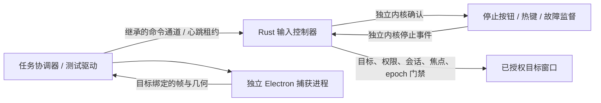

# Windows 本机控制验证矩阵

日期：2026-11-01；[验证 Windows 本机控制与人工接管闭环](https://github.com/Slmplez/TROOP/issues/6)仍是唯一任务状态源。

**未完成全部验证。** 本表区分已经观察到的行为、当前源码的复测状态，以及需要人工/硬件的项目。不能将早一轮迭代的通过记录当作最终源码已全部回归通过。

## 已有证据

| 验证项 | 观察结果 | 证据 / 限定 |
|---|---|---|
| 图像定位后的点击 | 两种窗口位置/尺寸均真实命中，最大映射误差约 0.525 px | frame-click-results.json；单屏 DPI 96 |
| 锁屏取消排队动作 | WTS 清除已授权队列，解锁后超过原期限不重放 | queued-lock-results.json；原来的单进程输入原型 |
| 解锁捕获恢复 | 旧轨道结束，人工新观察后取得青色新帧及新点击 | capture-recovery-results.json；原来的单进程输入原型 |
| 独立输入进程 | Rust 控制器向独立目标进程成功点击；Electron 只捕获 | isolation-results.json / normal |
| 短暂失焦后返回 | 新增 WinEvent 前台事件锁存，300 ms 故障夹具使旧观察失效；恢复焦点后无旧动作，显式观察后新动作命中 | isolation-results.json / focus-pulse；仅自建窗口 |
| 捕获主循环阻塞 | 先取得真实媒体帧，再注入阻塞；停止确认约 24 ms，队列清空、期限后零输入 | isolation-results.json / capture-hang；不是自然发生的 WGC 卡死 |
| 捕获进程退出 | 注入退出码 73 后，停止确认约 20 ms，期限后零输入 | isolation-results.json / capture-exit；不是特定 GPU 崩溃复现 |
| 控制连接断开 | stdin EOF 后撤销授权、清空队列，期限后零输入 | isolation-results.json / channel-eof；毫秒时钟记录为 0 ms，不意味着零耗时 |
| 协调端心跳失联 | 停止续租后约 610 ms 清空队列；原型租约为 700 ms | isolation-results.json / lease-timeout；从最后心跳起算，参数不是生产 SLA |
| 控制器被终止 | Job Object 随句柄关闭回收它创建的专用目标 | isolation-results.json / helper-crash；绝不能将此规则用于用户现有应用 |
| 目标进程被终止 | 检测退出并停止，约 9 ms，期限后零输入 | isolation-results.json / target-crash |
| 未授权/旧 epoch/错误目标 | 均在提交前拒绝 | isolation-results.json；每个场景都有前置拒绝轨迹 |
| 跨完整性应用门禁 | 真正创建低完整性 4096 / UIAccess=0 子进程，对中完整性 8192 / UIAccess=0 目标返回 higher_integrity_target；策略路径零 OS 调用 | isolation-results.json / permission；共享完整性门禁，未运行管理员窗口 |
| OS 跨完整性诊断 | 独立绕过应用门禁的诊断返回 3/3，但目标 0 次命中；随后同目标中完整性正对照实际命中 | isolation-permission-diagnostic.json 和 isolation-results.json；保留不一致结果，不判定 OS 操作成功或单一 UIPI 根因 |
| 日志背压时停止确认 | 当前源码的内核停止确认成功；1853 条诊断消息被丢弃，最终 stopped=true、grant=false、pending=false | isolation-stop-transport-results.json；**该次没有有效观察或排队动作**，不能合并成“背压下排队取消已验证” |
| 捕获最小化/恢复/尺寸变化 | 最小化后 1 秒等待没有新帧，但轨道仍 live；恢复并改变尺寸后，旧流取得 1086×642 青色新帧 | capture-lifecycle-results.json；无授权、无观察、无输入，不代表所有应用的最小化行为 |
| 捕获重建与目标关闭 | 显式重建使旧轨道 ended，新轨道得到 900 个青色像素；关闭目标后无新帧、轨道 ended、源不再枚举 | capture-lifecycle-results.json；目标关闭时 Chromium 报 WGC source closed / GetFrame failed，符合本次故障注入 |

isolation-results.json 中的独立进程行为来自第四轮中间迭代：10 项中 9 项通过，观察超时用例被驱动的旧 epoch 阻断，未验证 TTL。随后增加了有界异步诊断日志和独立内核 ACK，并修正驱动在捕获及权限正对照后读取最新观察 epoch。停止传输和捕获生命周期分别获得了后续版本的独立证据；当前源码仍需在前台条件恢复后完整重跑。旧运行未保存源码快照，不能用当前源码哈希追认旧结果。

## 尚未完成

| 项目 | 当前原因 | 精确补测步骤 / 通过条件 |
|---|---|---|
| 当前源码完整回归 | 新测试窗不能取得前台；已得到 target_not_foreground，0 次输入 | 保持专用窗口可取得前台后运行 run-isolation.ps1 -Scenario all；11 项全部通过，保留新证据 |
| 观察超时 | 原演练误用首次 epoch，被门禁正确拒绝；驱动已改用最新观察 epoch，但前台门禁阻止重跑 | stale-observation：观察超过 5 秒后提交，必须记录 observation_expired 且零输入 |
| 排队 + 日志背压 | 只完成无队列的停止传输核对 | output-backpressure：真实帧和有效队列；暂停 stdout 消费后，内核 ACK、恢复后的状态和独立目标计数均确认停止 |
| OS 部分提交 / 结果不明 | 已补齐部分提交时撤销观察并设置停止 ACK 的源码路径；尚无该返回值的实测样本 | 注入可识别的部分提交结果，验证不重试、授权撤销、ACK 可达，随后由用户核对外部效果；不得把当前正常 3/3 样本外推 |
| 捕获阻塞时真实停止热键 | Computer Use 应用授权等待超时，未按下热键；随后演练超时退出 | hotkey-stop：目标前台，Ctrl+Shift+F12 触发同一停止事件，队列清空且期限后无输入 |
| 捕获阻塞时窗口停止按钮 | 同一应用授权尚未取得，未尝试触发 | button-stop：点击专用目标中的停止按钮，验证内核 ACK、授权撤销及无旧输入 |
| 独立进程版本的真实锁屏 | 已有锁屏证据属于此前单进程输入实现 | 在独立 helper 有有效队列时人工锁定/解锁，验证新架构的观察失效、停止和显式恢复；不得自动操作锁屏 |
| 管理员目标与 UAC | 未请求用户提权，不改变 UAC 设置 | 用户在场时手动启动专用高完整性目标；验证中→高预检拒绝、人工接管提示；不自动确认系统界面 |
| 混合 DPI 多屏/负坐标/拔插 | 用户暂无第二屏，已明确同意待硬件验证 | 按 README 显示矩阵补测，仍属首版完整能力验收 |
| RDP / UIA 兼容边界 | 当前无对应会话或 UIA 目标夹具 | 对所承诺支持的环境分别取证；当前原型拒绝 RDP，不能宣称支持 |
| 长时间捕获、遮挡和设备变化 | 已有最小化/恢复/尺寸变化/关闭的短时样本，尚无长时间或设备故障矩阵 | 记录新帧时间、卡顿与资源占用；变化后旧观察失效，必须重新确认目标与新帧，不能仅检查轨道 live |

## 本轮架构结论（可继续验证的建议，不是生产实现）



- 捕获进程不能直接发送输入；控制器不等待捕获调用完成才处理停止。
- 媒体轨道的 live 状态不代表有可用新画面。观察必须绑定目标、捕获代际、几何版本和单调时间；最小化、帧超时或几何改变使旧观察失效，恢复出帧本身不能自动恢复输入资格。
- 停止确认只表示该运行的授权已撤销、未提交动作已清空；已进入 OS 的短动作仍需核对，不能撤回或盲目重试。
- 诊断日志必须与停止状态更新隔离。原型允许有界诊断队列丢消息以验证控制不阻塞；**生产审计账本不能沿用丢弃策略**，应独立持久化并定义缺失/结果不明语义。
- 生产 IPC 还需同用户权限、连接/进程身份验证、运行代际与消息大小/顺序约束。当前继承 stdin、命名事件和固定子进程仅证明原型边界，不是完成的授权协议。
- Job Object 只清理应用拥有的子进程。用户原本打开的浏览器、编辑器或管理员工具不属于可强制结束的范围。
- 捕获后端暂保留已跑通的 Electron 定向媒体路径；原生 Rust WGC 是未验证候选，不要求同时实现两个后端来满足同一功能。是否冻结选择仍取决于剩余生命周期和显示矩阵证据。

## 可复现入口

```powershell
# 在用户桌面前台条件满足时：完整自动矩阵，不包含人工停止入口
./.scratch/troop-windows-control/run-isolation.ps1 -Scenario all
# 不依赖有效观察，无排队、无输入：仅背压下的停止传输
./.scratch/troop-windows-control/run-isolation.ps1 -Scenario stop-transport
# 无授权、无输入：最小化、恢复并改变尺寸、重建捕获、关闭自建目标
./.scratch/troop-windows-control/run-isolation.ps1 -Scenario capture-lifecycle
# 需允许 Computer Use 或人工在专用窗口操作
./.scratch/troop-windows-control/run-isolation.ps1 -Scenario hotkey-stop
./.scratch/troop-windows-control/run-isolation.ps1 -Scenario button-stop
```

未取得观察前置条件时，完整矩阵现在会立即停止后续重复启动。恢复工作不需要重做旧历史导入或已通过的旧版锁屏实验，只需完成本表明确的缺口。

依据：[SendInput 的返回值与 UIPI 限制](https://learn.microsoft.com/en-us/windows/win32/api/winuser/nf-winuser-sendinput)、[Windows 完整性控制](https://learn.microsoft.com/en-us/windows/win32/secauthz/mandatory-integrity-control)、[受限令牌](https://learn.microsoft.com/en-us/windows/win32/api/securitybaseapi/nf-securitybaseapi-createrestrictedtoken)、[进程外 WinEvent 通知](https://learn.microsoft.com/en-us/windows/win32/api/winuser/nf-winuser-setwineventhook)。
